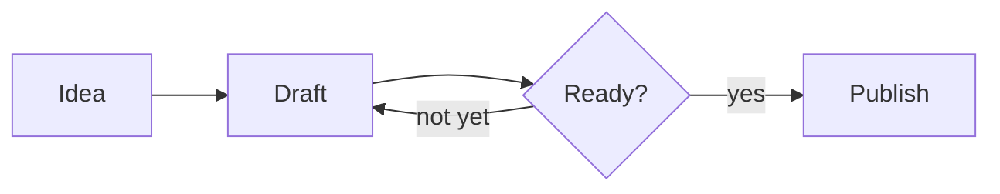

# Writing, without the noise

Folio is a quiet place to write Markdown. Type on the left, read on the right. Everything stays in your browser — nothing is uploaded, and your draft is saved as you type.

> [!TIP]
> Press <kbd>⌘</kbd> <kbd>K</kbd> for every command — insert a table, switch theme, jump to a heading. Drop a `.md` file anywhere to open it, and <kbd>⌘</kbd> <kbd>S</kbd> downloads what you have written.

## The basics

Markdown keeps formatting in plain sight. Wrap words in `**` for **strong emphasis**, in `*` for *a softer touch*, or in `~~` to ~~strike them out~~. Inline `code` sits in backticks, and [links](https://commonmark.org) look like this. Bare URLs such as https://github.github.com/gfm/ become links on their own.

### Lists

- Short lines, generous spacing
- Nested ideas when you need them
  - one level down
  - and back up again
- Nothing more

1. Write the first draft
2. Leave it alone for a day
3. Cut a third of it

### Tasks

Click a box in the preview — the source updates too.

- [x] Pick a calm typeface
- [x] Make dark mode feel native
- [ ] Write something worth reading

## Code

Fenced blocks are highlighted for most languages. Hover one to copy it.

```ts
type Draft = { title: string; body: string };

export function wordCount({ body }: Draft): number {
  return body.split(/\s+/).filter(Boolean).length;
}
```

```python
def reading_time(words: int, wpm: int = 230) -> str:
    minutes = max(1, round(words / wpm))
    return f"{minutes} min read"
```

```bash
npm create vite@latest my-notes -- --template vanilla-ts
```

## Tables

| Element     | Syntax              | Notes                    |
| ----------- | ------------------- | ------------------------ |
| Heading     | `# Title`           | Up to six levels         |
| Emphasis    | `*italic*`          | Or `_underscores_`       |
| Code block  | ` ``` `             | Add a language for color |
| Footnote    | `[^1]`              | Collected at the end     |

## Quotes and callouts

> Simplicity is not the goal. It is the by-product of a good idea and modest expectations.
>
> — Paul Rand

> [!NOTE]
> Callouts use GitHub's syntax, so a README looks the same here as it will on GitHub.

> [!WARNING]
> Your draft lives in this browser only. Download it before clearing site data.

## Math and diagrams

Inline math sits between single dollars, like $e^{i\pi} + 1 = 0$, while prices such as $5 stay plain text. Display math gets its own lines:

$$
\int_{-\infty}^{\infty} e^{-x^2}\,dx = \sqrt{\pi}
$$

Diagrams are written in Mermaid and drawn in the page's own colors:



## Odds and ends

Footnotes keep asides out of the way.[^1] Raw HTML works for the rare case Markdown cannot cover — <mark>highlighted text</mark>, <sub>subscripts</sub>, or a collapsible section:

<details>
<summary>What is saved, and where?</summary>

The current document, its title and your view settings are kept in this browser's local storage. The share link carries the whole document inside the URL itself, so there is still no server involved.

</details>

---

Start writing whenever you are ready. *New document* gives you a blank page, *Focus mode* dims everything but the paragraph you are on, and *Show example* brings this page back. Hover the dashes at the right edge of the preview for an outline.

[^1]: Like this one. Click the arrow to jump back.
